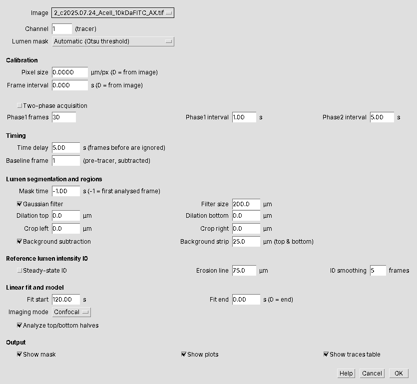
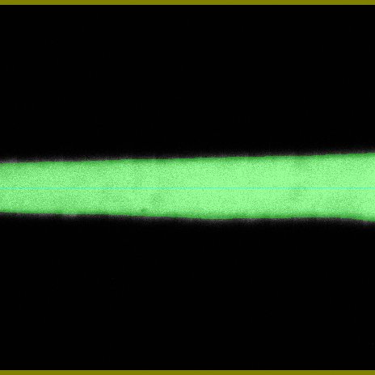
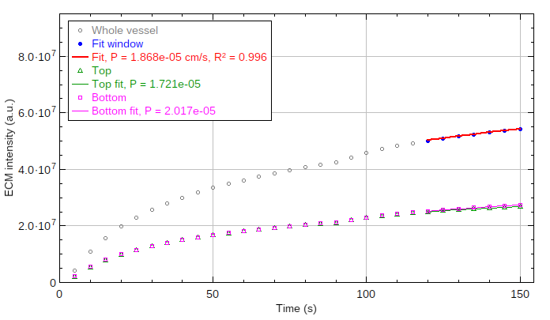

# Vessel Permeability — Fiji / ImageJ plugin

Measures the apparent permeability (P<sub>app</sub>) of a cylindrical
microvessel from a fluorescence time-lapse of tracer perfusion, directly
on any image open in Fiji. This is a port of the MATLAB
*VesselPermeabilityAnalysis* toolbox in the [repository root](../README.md).
It uses the same method and gives the same numbers on the example dataset.

If you use the plugin, please cite the software (see
[`CITATION.cff`](../CITATION.cff) and the [main README](../README.md#citation)):

> Holter JC, Adorno JJ, Agarwal SS, Tinapple JW, Barlage JM, Song JW, Jones TH.
> (2026). *VesselPermeabilityAnalysis* [Software]. Zenodo.
> https://doi.org/10.5281/zenodo.23301971

---

## Installation

1. Close Fiji.
2. Download **`Vessel_Permeability-<version>.jar`** from the
   [GitHub releases](https://github.com/songlab-osu/vessel_permeability/releases)
   page (or build it, see below) and copy it into the `plugins` folder of your
   Fiji installation:
   - Windows / Linux: `Fiji.app/plugins/`
   - macOS: right-click *Fiji.app* → *Show Package Contents* → `plugins/`

   (Alternatively, with Fiji open: *Plugins › Install…* and choose the jar.)
3. Start Fiji. The plugin appears under
   **Plugins › Vessel Permeability › Analyze Vessel Permeability…**

Works with any current Fiji (Java 8 or newer) and with plain ImageJ 1.54+.
To update, replace the jar and restart. To uninstall, delete it.

## Opening your data

- **ND2 (and other microscope formats):** drag the file onto Fiji or use
  *File › Import › Bio-Formats* (Bio-Formats ships with Fiji). In the import
  dialog choose *View stack with: Hyperstack*. Leave *Split channels*
  **unchecked** — the plugin selects the channel itself.
- **TIFF:** *File › Open*.

Check *Image › Properties* (Ctrl+Shift+P): **Pixel width** should be in
microns and **Frame interval** in seconds. Bio-Formats fills these in from
the ND2 metadata. If they are missing, enter them in the plugin dialog.

The image should be a single-plane time-lapse with the vessel running
roughly **horizontally**. Multi-channel hyperstacks are fine. Z-stacks must
be projected first (*Image › Stacks › Z Project*).

## Running the analysis

*Plugins › Vessel Permeability › Analyze Vessel Permeability…*



| Field | Meaning | MATLAB option |
|---|---|---|
| **Image** | Any open image (drop-down) | – |
| **Channel** | Tracer channel (1-based) | `channel` |
| **Lumen mask** | *Automatic (Otsu)*, or any open binary mask image of the same size | `mask_mode` |
| **Pixel size** | µm/pixel; **0 = from image calibration** | `pixel_size_um` |
| **Frame interval** | s; **0 = from image calibration** | `frame_interval_s` |
| **Two-phase acquisition** + phase fields | Two frame rates (phase-1 frames at phase-1 interval, then phase-2 interval) | `multiphase`, `phase1_*`, `phase2_int` |
| **Time delay** | Frames before this time are ignored; the first frame after it gives I<sub>0</sub> | `t_delay` |
| **Baseline frame** | Pre-tracer frame subtracted from all frames | `baseline_frame` |
| **Mask time** | Time of the frame thresholded for the automatic mask; −1 = first analysed frame | `mask_time` |
| **Gaussian filter / Filter size** | Smooth before thresholding | `filter`, `filter_size_um` |
| **Dilation top / bottom** | Margin around the lumen excluded from the ECM region (µm) | `dilation_top_um`, `dilation_bot_um` |
| **Crop left / right** | Remove image edges (µm) | `crop_um` |
| **Background subtraction / strip** | Subtract the mean of the top and bottom strips each frame | `background_subtract`, `background_roi_um` |
| **Steady-state I0**, erosion line, smoothing | Use the peak lumen intensity instead of the first frame | `I0_steady`, `erosion_line_um`, `I0_smooth_frames` |
| **Fit start / end** | Linear-fit window, absolute time (s); end 0 = end of recording | `analysis_start`, `analysis_end` |
| **Imaging mode** | *Confocal* (P = d/2 · dI/dt / I<sub>0</sub>) or *Widefield* (d/4) | `imaging_mode` |
| **Analyze top/bottom halves** | Also report P<sub>app</sub> above and below the vessel centroid | `half` |
| **Show mask / plots / traces table** | Which outputs to display | `plot_mask`, `plot_graph` |

Settings are remembered between sessions. **Help** in the dialog shows a
short summary.

## Outputs

**Permeability Results** table — one row per analysis, appended so several
vessels accumulate in one table: image, channel, diameter (µm),
P<sub>app</sub> whole/top/bottom (cm/s), R² of each fit, dI/dt, I<sub>0</sub>
and its time, fit window and number of points, pixel size, imaging mode, mask,
time delay, dilation and any warnings. Save with *File › Save As…* in the table
window (CSV).

**Mask** image — the first analysed frame with the lumen in green, the
dilation margin excluded from the ECM in magenta, the background strips in
yellow, and (for halves) the centroid split in cyan.



**ECM intensity** plot — I(t) for the whole vessel (and halves), with the fit
window and fitted lines; P<sub>app</sub> and R² in the legend.



**Lumen intensity** plot — I<sub>0</sub>(t) with the reference point marked.

**Traces** table (optional) — time, I, I<sub>0</sub> (and halves) per frame,
with a flag for points used in the fit, for re-plotting elsewhere.

A one-line summary of each analysis is also written to the **Log** window.

## Batch processing a folder

`macros/Batch_Vessel_Permeability.ijm` analyses every file in a folder with
one set of settings. It saves `Permeability_Results.csv` and the three figures
per image as PNGs.

1. Get your settings string: *Plugins › Macros › Record…*, run the plugin once
   on a representative image, and copy the recorded options (everything after
   `image=[…]`).
2. Open the macro (*File › Open*), click **Run**, choose the input and output
   folders, the file extension (e.g. `.nd2`), and paste the settings.

Files that fail (e.g. too few frames) are reported in the Log and skipped. The
batch continues.

The plugin can also be called from your own macros:

```
run("Analyze Vessel Permeability...", "image=[vessel1.nd2] channel=1 lumen_mask=[Automatic (Otsu threshold)] pixel_size=0 frame_interval=0 time_delay=5 baseline_frame=1 mask_time=-1 gaussian_filter filter_size=200 dilation_top=0 dilation_bottom=0 crop_left=0 crop_right=0 background_subtraction background_strip=25 erosion_line=75 i0_smoothing=5 fit_start=120 fit_end=0 imaging_mode=Confocal analyze_top/bottom_halves show_mask show_plots");
```

## Agreement with the MATLAB version

On the example time-lapse in this repository
(`example_data/4_s2026.05.02_cAMP_10kDaBlue_AX.tif`), with the settings of
`example_experiments/example_vessel.m` (time delay 5 s, dilation 10 µm above
and below, halves on):

| | MATLAB v1.0.0 (R2025b) | Plugin | Difference |
|---|---|---|---|
| Diameter (µm) | 206.51 | 206.72 | +0.10% |
| P<sub>app</sub> (cm/s) | 6.849×10⁻⁷ | 6.832×10⁻⁷ | −0.25% |
| P<sub>app</sub> top (cm/s) | 6.381×10⁻⁷ | 6.372×10⁻⁷ | −0.14% |
| P<sub>app</sub> bottom (cm/s) | 7.327×10⁻⁷ | 7.302×10⁻⁷ | −0.34% |
| R² | 0.9223 | 0.9223 | – |

The MATLAB values are stored in `example_data/reference_results.csv`, and
`mvn package` runs a test
(`src/test/java/vesselpermeability/ExampleAgreementTest.java`) that fails if
the plugin moves more than 1% from them. Known sources of the small
differences:

- **Lumen dilation** uses an exact Euclidean disk; MATLAB's `strel('disk')`
  uses a polygonal approximation. This only matters when dilation > 0, and
  only at the pixel level.
- **Lumen mask:** on this image the plugin's automatic mask is about 0.1%
  (≈23 pixels) larger than MATLAB's, which accounts for the diameter
  difference.
- **Timing** comes from the image's frame interval (or the two-phase
  settings). The MATLAB version reading ND2 directly can use per-frame
  timestamps. For constant-rate acquisitions the two are identical.

## Building from source (optional)

A JDK (8 or newer) is needed; Fiji's bundled Java usually has no compiler.

```bash
./build.sh /path/to/Fiji.app/jars/ij-1.54f.jar        # macOS / Linux
build.bat C:\path\to\Fiji.app\jars\ij-1.54f.jar        # Windows
# or, with Maven:
mvn package
```

The jar appears in `build/` (or `target/` for Maven). Source layout:

```
src/main/java/vesselpermeability/
  Vessel_Permeability.java     dialog, image/calibration handling, outputs
  PermeabilityAnalyzer.java    the analysis (no GUI; reusable from scripts)
  PermeabilityParams.java      settings, defaults, validation, saved prefs
src/main/resources/plugins.config   menu entries
macros/Batch_Vessel_Permeability.ijm
```

The jar file name must keep its underscore (`Vessel_Permeability…`). ImageJ
only loads plugin jars whose names contain one.

## Troubleshooting

| Message | Fix |
|---|---|
| *has no spatial calibration* | Set *Image › Properties* pixel width/unit, or enter Pixel size in the dialog |
| *has no frame interval* | Set Frame interval in *Image › Properties* or in the dialog |
| *z-slices… only single-plane time-lapses* | *Image › Stacks › Z Project*, or re-import as a time series |
| *first analysed frame must come after the baseline frame* | Increase Time delay so analysis starts after the pre-tracer frame |
| *Only N frame(s) in the fit window* | Widen Fit start/end |
| Warning: *background strips overlap the lumen* | Reduce Background strip, crop, or check the channel |

## License

MIT — see [`LICENSE`](../LICENSE) in the repository root.
